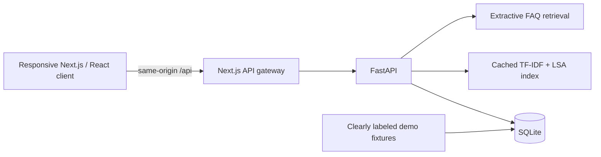

# Implementation architecture

Next.js, React and TypeScript implement one connected browser application. Requests go through a same-origin route-handler proxy that reads `API_URL` at request time, preserves session cookies, and reports backend failures. FastAPI owns authentication, validation, per-organization authorization, persistence, retrieval and calendar exports. SQLite makes the first build reproducible without a cloud account. Authentication uses salted scrypt password hashes and database-backed opaque sessions, transmitted in an HTTP-only cookie. Sessions can be invalidated at logout and account deletion.

The requested Supabase/PostgreSQL/pgvector stack is a production migration target, not an active integration. Local SQLite does **not** provide PostgreSQL row-level security. Backend ownership checks protect each local endpoint; future direct database/API access must use tested RLS before exposure. No Supabase, NetID, Rutgers API, paid model, email delivery, native mobile, or background notification integration is claimed.

## Retrieval and recommendations

The local engine fits TF-IDF and a latent semantic analysis (LSA) projection to the fixture corpus and caches the index. Hybrid ranking combines lexical and dense vector cosine similarity. Campus and predictable time/fee/beginner constraints are applied deterministically. Recommendations combine declared preferences with explicit follow/dismiss actions and category diversity; explanations cite stored attributes rather than generating new facts.

LSA learns co-occurrence in a very small synthetic corpus. It is not a pretrained general-language embedding model and cannot reliably understand arbitrary paraphrases. Compare it honestly with the lexical baseline before choosing a hosted embedding model. Data/evaluation labels are synthetic and hand-authored; they cannot establish real-world recommendation quality. Do not tune on this small fixture suite and present it as a held-out study.

The FAQ assistant retrieves and quotes approved structured answers. It is extractive: it does not call an external LLM or implement generative RAG. This reduces unsupported generation, but relevance selection can still be wrong; evaluate source support, relevance, and missing-answer behavior separately. Unsupported questions are refused with a contact fallback. Organization content is data, never model/system instructions.

## Persistence and production path

The local database stores clubs/events and private users, sessions, preferences, saved items, follows, RSVP intentions, officer assignments and reports. SQLite is a single-instance development deployment; use a persistent local disk or the Compose named volume. Runtime databases are ignored by Git.

Before a campus pilot, provision authenticated production infrastructure, migrate to Supabase Auth/PostgreSQL, enforce RLS at every exposed table, verify officers out of band, import authorized real records, implement verified email and recovery flows, test backups and restore, configure HTTPS/secure cookies, shared rate limiting and monitoring, and validate the revised system with users. Deployment instructions make the current app runnable; they do not certify a production launch.

## Technical references

- [Next.js App Router installation](https://nextjs.org/docs/app/getting-started/installation)
- [FastAPI security guidance](https://fastapi.tiangolo.com/tutorial/security/oauth2-jwt/)
- [Supabase row-level security](https://supabase.com/docs/guides/database/postgres/row-level-security)
- [scikit-learn latent semantic analysis](https://scikit-learn.org/stable/modules/decomposition.html#truncated-singular-value-decomposition-and-latent-semantic-analysis)
